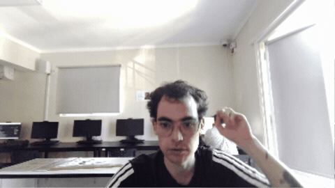

# Bitácora

> Francisco Arturo Benavides Riquelme

## Página web

Primero hicimos una página web en GitHub y fuimos aprendiendo poco a poco cómo utilizar el programa; esta fue la página que hice yo.

[Ver mi página](https://fran19-jpg.github.io/multimedial/w/index.html)

---

## Touch Designer

### Experimentación

Luego hicimos ejercicios en Touch Designer, un programa de edición de video, y estos fueron algunos de mis resultados.

Este resultado fue la base para mi proyecto final, donde llevé esas pruebas a una idea más compleja y expresiva.

Exploré la distorsión visual, la interferencia y la percepción de la realidad.

A partir de estas pruebas, desarrollé una propuesta más clara y más intensa.

[Descargar archivo Touch](files/archivo-touch.toe)

---

## Inteligencia artificial

### Experimentación con IA

#### Imágenes generadas

Luego usamos Comfy para generar imágenes con IA; aquí están mis resultados.

[Ver resultados](https://drive.google.com/drive/folders/1UK8mEanDISQHmxmBUMvyscWsUJ8UG1vo?usp=sharing)

---

## Resultado final

### Touch Designer

#### Vídeo distorsionado

Luego de mucho esfuerzo y sudor, llegué al resultado final: un video distorsionado con audio, el cual trata sobre un ser humano con locura hablando locura; el video se ve interferido para que sus locuras no puedan ser transmitidas, haciendo como si el loco tuviera la razón y una tecnología superior lo estudiara, silenciando esta idea. Esta obra se relaciona con mi investigación de este año, donde exploro la alteración de la verdad y la modificación de los relatos, siendo vistos desde distintos puntos de vista. En este caso, la obra se ve desde el punto de vista del «locuto» que cree que tiene la razón.

- [Guion](files/guion-resumen.txt)
- [Ver proyecto](files/obra-touchdesigner.toe)

---

## Bitácora

### Guardar entrada

Esta sección permite guardar una entrada localmente en el navegador.

- Fecha
- Título
- Descripción

Ejemplo de entrada:

- 12/11/2026 — Reunión de equipo
- Descripción: Trabajamos en el proyecto de la página web y ajustamos el diseño.

---

## Archivos del proyecto

- [index.html](index.html) — página principal
- [styles.css](styles.css) — estilos visuales
- [script.js](script.js) — lógica de la bitácora
- [media/giphy-visual.gif](media/giphy-visual.gif) — GIF del encabezado
- [files/archivo-touch.toe](files/archivo-touch.toe) — archivo Touch Designer de prueba
- [files/obra-touchdesigner.toe](files/obra-touchdesigner.toe) — proyecto final
- [files/guion-resumen.txt](files/guion-resumen.txt) — texto del guion o resumen

---

## Cómo abrir el proyecto

Puedes abrir la carpeta localmente en un navegador o ejecutarla con Python:

```bash
python -m http.server 8000
```

Después visita:

```text
http://localhost:8000/
```

---

## GitHub

Si quieres subir este proyecto a GitHub, usa estos pasos:

```bash
git init
git add .
git commit -m "Primer commit"
git branch -M main
git remote add origin https://github.com/TU_USUARIO/TU_REPOSITORIO.git
git push -u origin main
```

Este README ya funciona como una versión textual de la página para poder verla solo escrita en Markdown.
